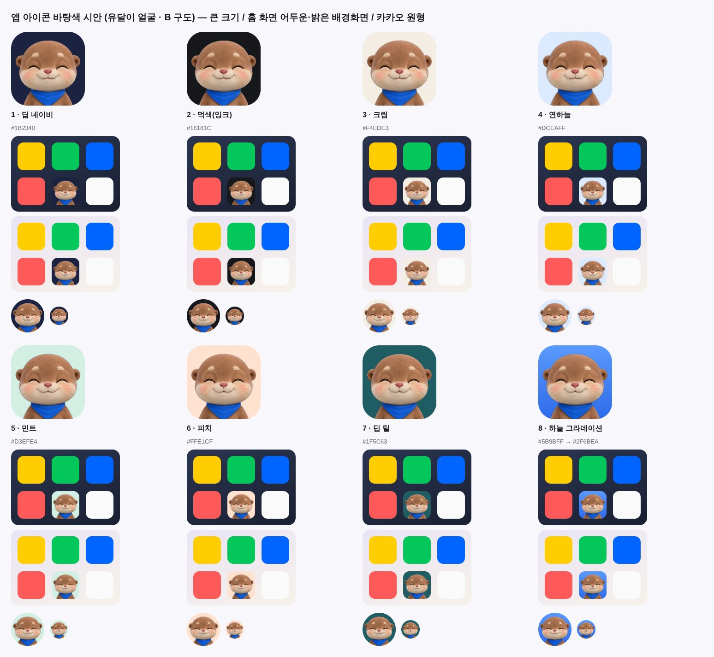
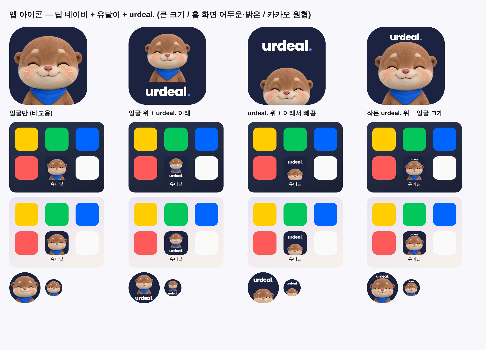
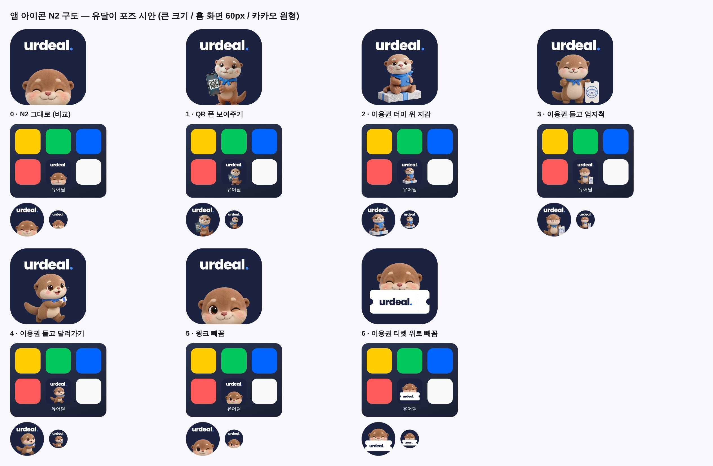
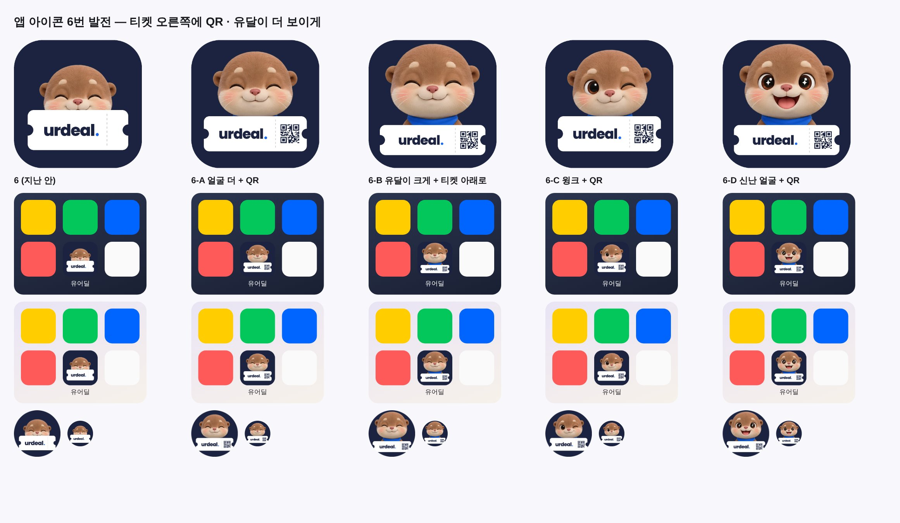
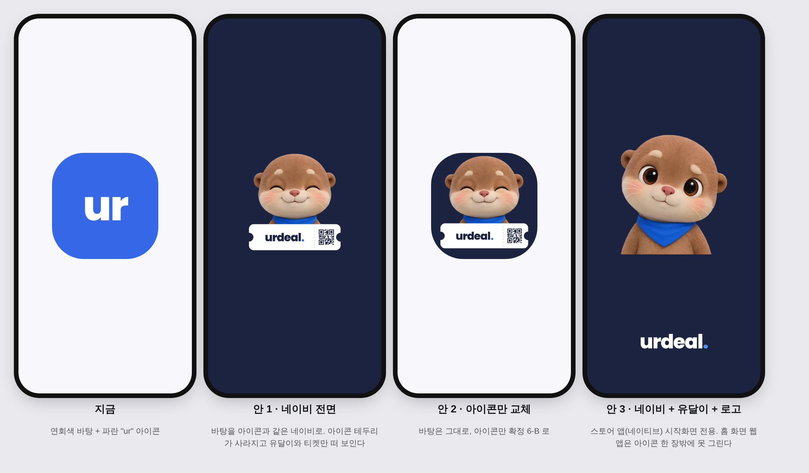
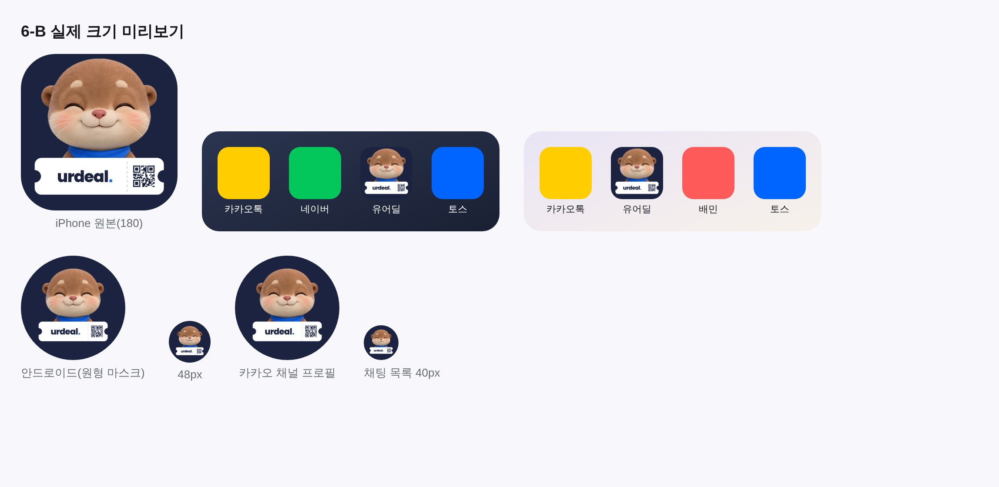

# 앱 아이콘 유달이 시안 — 2026-10-11

대표: *"앱 로고나 파비콘도 유달이로 바꾸는게 좋을까? 서비스 로고도 그렇고?"* → 권고(로고·파비콘 유지, 앱 아이콘만 검토) → *"앱 아이콘 시안 만들어볼래?"*

| 안 | 형태 |
|---|---|
| A | 지금 — 파란 바탕 + 흰 "ur" |
| B | 유달이 얼굴 + 파란 바탕 |
| C | 유달이 얼굴 + 흰 바탕 |
| D | 유달이 얼굴 + 연파랑 바탕 |
| E | "ur" 위 + 아래서 빼꼼 얼굴 |

원본 1024px: `assets/app-icon-2026-10/icon-*.png` (얼굴 = `mascot/otter-face-happy.png`).
범위: 홈 화면 아이콘(apple-touch-icon·PWA)과 카카오 채널 프로필. **서비스 로고 "urdeal."·파비콘은 유지 권고.**

## 확정
- [ ] 대표 선택 대기

## 바탕색 시안 (2026-10-11, 대표 *"일단 바탕 색을 변경해야 할 것 같아. 지금 파란색은 촌스러운 색이야."*)

1 딥 네이비 #1B2340 · 2 먹색 #16181C · 3 크림 #F4EDE3 · 4 연하늘 #DCEAFF · 5 민트 #D3EFE4 · 6 피치 #FFE1CF · 7 딥 틸 #1F5C63 · 8 하늘 그라데이션 #5B9BFF→#2F6BEA

## 딥 네이비 확정 + 워드마크 동반 시안 (대표 *"딥 네이비로 해야지. 그리고 앱 로고는 urdeal 로고도 보여줘야 하지 않을까? 같이 나온 형태로"*)

N1 얼굴 위 + urdeal. 아래 · N2 urdeal. 위 + 아래서 빼꼼 · N3 작은 urdeal. 위 + 얼굴 크게. 바탕 #1B2340, 점 #4D8DF5(다크 브랜드 글자색).

## N2 구도 포즈 시안 (대표 *"N2가 좋은데 유달이의 다른 포즈가 필요하지 않을까? … 이용권에 관한 느낌이 더 필요하거나"*)

0 N2 그대로 · 1 QR 폰 보여주기 · 2 이용권 더미 위 지갑 · 3 이용권 들고 엄지척 · 4 이용권 들고 달려가기 · 5 윙크 빼꼼 · 6 이용권 티켓 위로 빼꼼(티켓에 urdeal.)

## 6번 발전 — QR + 유달이 더 보이게 (대표 *"6번에서 QR코드도 같이 들어가면 좋지 않을까? 유달이 조금 더 보여지게 해서"*)

6-A 얼굴 더 + QR · 6-B 유달이 크게 + 티켓 아래로 · 6-C 윙크 + QR · 6-D 신난 얼굴 + QR. 생성 스크립트 `assets/app-icon-2026-10/make-qr-icons.py`(QR 은 장식용 패턴 — 실제 코드 아님).

## 시작화면 시안 (2026-10-11 대표 *"시작화면 디자인이야 지금. 너무 별로야"*)

지금 시작화면 = 홈 화면 웹앱(PWA)이 **manifest 바탕색(#F8F7FC) + 아이콘** 두 가지로 자동 생성한 화면이다. 그래서 바꿀 수 있는 손잡이는 둘뿐이다(글자·애니메이션 불가).
안 1 네이비 전면(바탕 #1B2340 + 6-B maskable — 테두리가 사라져 유달이와 티켓만 뜬다) · 안 2 아이콘만 6-B · 안 3 네이비 + 유달이 + urdeal.(스토어 앱 네이티브 시작화면 전용).
- [x] **안 1 확정** (2026-10-11 대표 *"안1로 해줘"*) — manifest `background_color` `#1B2340` + 6-B maskable. `theme_color` 는 `#F8F7FC` 유지(앱 화면 상단 바 색 — 시작화면과 무관). 스토어 앱 시작화면도 같은 네이비로 맞췄다(`capacitor.config.ts` + `android/app/src/main/res/drawable*/splash.png`).
- [x] **아이폰** (2026-10-11 대표 *"아이폰 시작화면도 해줘"*) — 홈 화면 웹앱은 manifest 를 안 보고 `apple-touch-startup-image`(기기 픽셀과 **정확히 같은 크기**만 씀)를 본다 → `public/ios-splash-{W}x{H}.png` 12종 + `index.html` 선언 + `_routes.json` exclude. 스토어 앱은 `ios/App/App/Assets.xcassets/Splash.imageset` 2732² 3장을 네이비로 재생성. 아이콘 = 짧은 변의 42%(안드로이드와 같은 비율). 생성 `scripts/app-icon/make-ios-splash.py`.

## ✅ 6-B 적용 (2026-10-11 대표 *"6-B가 가장 좋고"* → *"일단 2번으로 만들어봐"* — 확정 유달이 그림만 사용)

| 자리 | 파일 | 비고 |
|---|---|---|
| iPhone 홈 화면 | `public/apple-touch-icon.png`(180) · `app-icon-192.png` | 6-B 그대로 |
| 안드로이드 홈 화면(manifest any) | `public/app-icon-192.png` · `app-icon-512.png` | |
| 안드로이드 원형·물방울 마스크(manifest maskable) | `public/app-icon-maskable-*.png` | 그림을 82%로 줄여 안전영역(지름 80%) 안에 |
| 카카오 채널 프로필 | `assets/app-icon-2026-10/kakao-channel-profile-640.png` | **대표가 카카오 비즈니스에서 직접 업로드** |

**안 바꾼 것(의도)**: 파비콘(`favicon*` · `favicon.svg` "ur") · `icon-192/512.png`(브라우저 탭 · 구글 검색 로고 JSON-LD · 푸시 알림 · 바로가기). 앱 아이콘은 새 파일명 `app-icon-*` 로 분리했다 — 같은 파일을 덮으면 검색 로고와 탭 아이콘까지 유달이로 바뀐다.
manifest 에서 `favicon.svg` 를 뺐다 — 크롬은 확대 가능한 SVG 를 우선 골라 홈 화면에 "ur" 이 깔릴 수 있다(테스트로 고정).

⚠️ **작은 크기 한계(실측 보드)**: 60px 홈 화면에서 `urdeal.` 는 읽히지만 QR 은 점무늬로 뭉개지고, 40px(카카오 채팅 목록)에선 글자도 안 읽힌다. 이미 설치된 PWA 는 브라우저가 다시 검사할 때(수일) 바뀐다.
