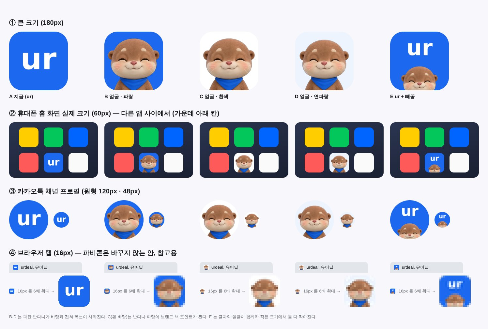

# 앱 아이콘 유달이 시안 — 2026-10-11

대표: *"앱 로고나 파비콘도 유달이로 바꾸는게 좋을까? 서비스 로고도 그렇고?"* → 권고(로고·파비콘 유지, 앱 아이콘만 검토) → *"앱 아이콘 시안 만들어볼래?"*

| 안 | 형태 |
|---|---|
| A | 지금 — 파란 바탕 + 흰 "ur" |
| B | 유달이 얼굴 + 파란 바탕 |
| C | 유달이 얼굴 + 흰 바탕 |
| D | 유달이 얼굴 + 연파랑 바탕 |
| E | "ur" 위 + 아래서 빼꼼 얼굴 |

원본 1024px: `assets/app-icon-2026-10/icon-*.png` (얼굴 = `mascot/otter-face-happy.png`).
범위: 홈 화면 아이콘(apple-touch-icon·PWA)과 카카오 채널 프로필. **서비스 로고 "urdeal."·파비콘은 유지 권고.**

## 확정
- [ ] 대표 선택 대기
