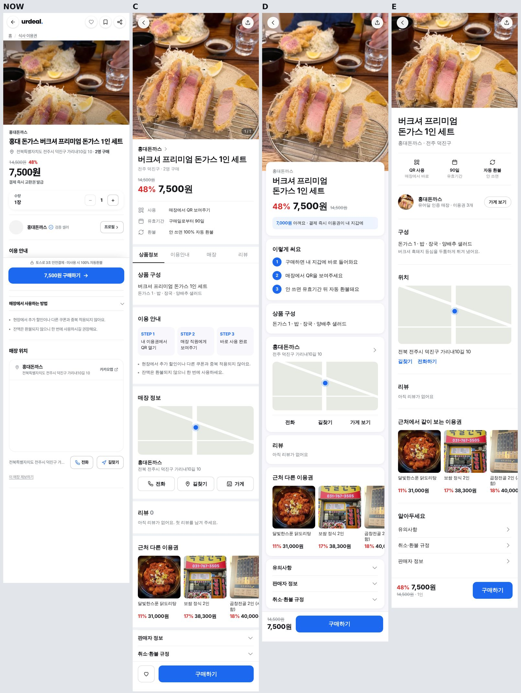

# 이용권 상세(`/pass/:id`) 재구성 시안 — 2026-10-11

대표: *"이용권 상세페이지 아직 UI가 마음에 안들어. 더 세련되고 심플해져야 해. 지금은 부연설명도 많고 그래."*
→ 1차 시안(A 정리형·B 압축형, 첫 화면만)에 *"맨 밑에까지 한번에 다 보여줘야지. 대기업들의 상세페이지 구성처럼 원해."*
→ *"시안들 더 받아보고 싶어."* — 아래 C·D·E 는 페이지 맨 아래까지 그린 전체 시안이다.

기준 상품: 2915 홍대돈까스 버크셔 프리미엄 돈가스 1인 세트(라이브 사진·가격). 근처 이용권은 라이브 활성 이용권.

## 지금 화면의 문제 (라이브 실측)
- 매장 이름 4번 · 주소 3번 반복
- 경로 표시(홈 / 식사 이용권) · 찜 아이콘 2개(하트+북마크)
- "결제 즉시 **교환권** 발급" — 용어 틀림(이용권)
- "발급 후 사용 기간 적용" — 뜻 없는 안내(유효기간 미입력 시 기본 문구)
- 수량 카드가 본문 한가운데를 차지
- "이 매장 제보하기" 링크가 본문 끝에 노출

## 시안
| | 구성 | 참고 |
|---|---|---|
| **C · 탭형** | 사진 1:1 → 가게›·제목·가격 → 핵심 3줄(사용·유효기간·환불) → 탭(상품정보·이용안내·매장·리뷰) → STEP 1·2·3 → 지도+전화/길찾기/가게 → 리뷰 → 근처 이용권 → 판매자 정보·취소환불 접기 → [찜][구매하기] | 쿠팡·배민 |
| **D · 카드형** | 큰 사진 위로 가격 카드가 겹쳐 올라옴 → "7,000원 아껴요" → 이렇게 써요 1·2·3 → 구성 → 매장 카드(지도) → 리뷰 → 근처 이용권 → 유의사항·판매자·환불 접기 → [가격][구매하기] | 카카오 선물하기·토스 |
| **E · 에디토리얼형** | 4:3 사진 → 큰 제목 → 아이콘 3칸(QR 사용·90일·자동 환불) → 가게 한 줄(아바타·가게 보기) → 구성 → 위치 → 리뷰 → 근처 이용권 → 알아두세요(유의·환불·판매자) → [가격][구매하기] | 에어비앤비·야놀자 |

공통: 수량은 구매하기를 누르면 뜨는 시트에서(큰 서비스 공통 패턴) · 제보하기는 판매자 정보 안으로 · 데이터 없는 칸(구성·유효기간·리뷰)은 숨김 또는 빈 상태 한 줄.
⚠️ 시안의 "구매일로부터 90일"·구성 문구는 **예시**다. 실제로는 매장이 입력한 값이 있을 때만 보인다.

## 구현 todo (확정 후)
- [ ] 대표 확정안 기록
- [ ] `GroupBuyDetailPage.tsx` 는 로딩 잠금 파일 — 마크업 변경은 [UNLOCK_LOADING] 승인 + audit log
