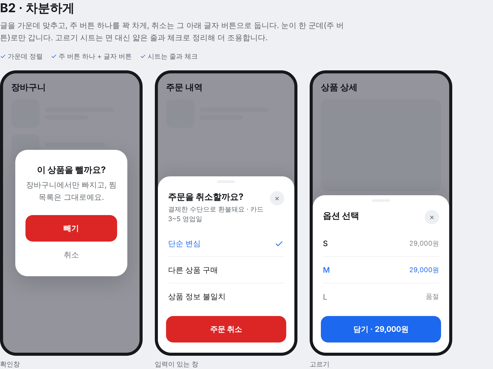
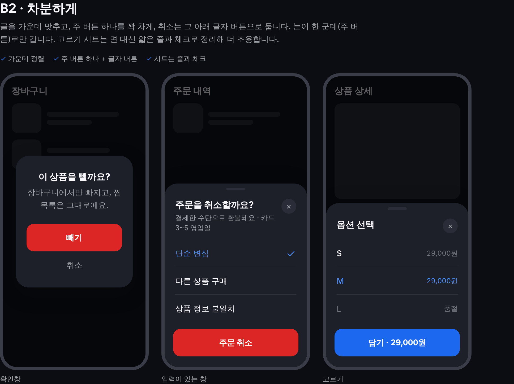
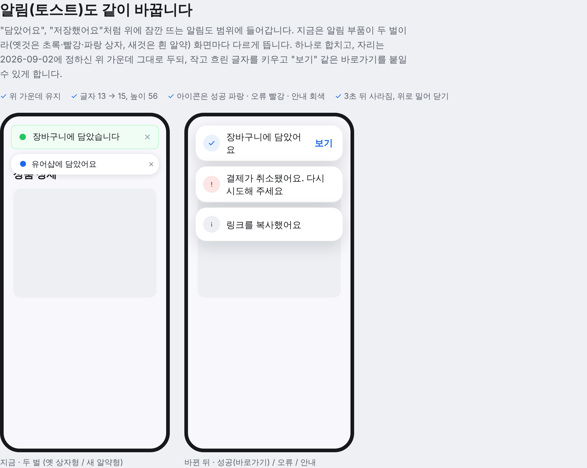
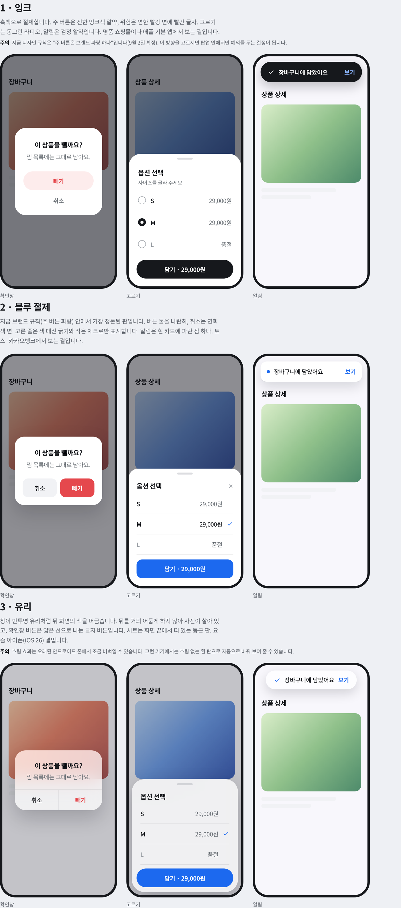
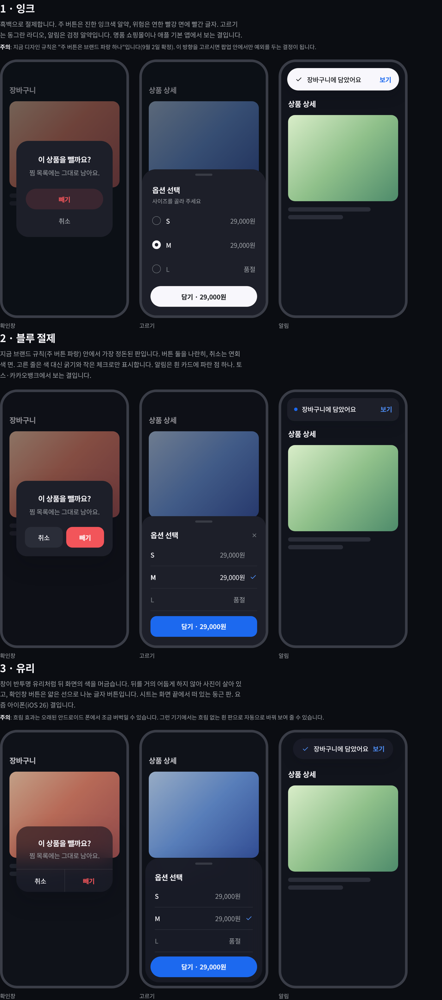
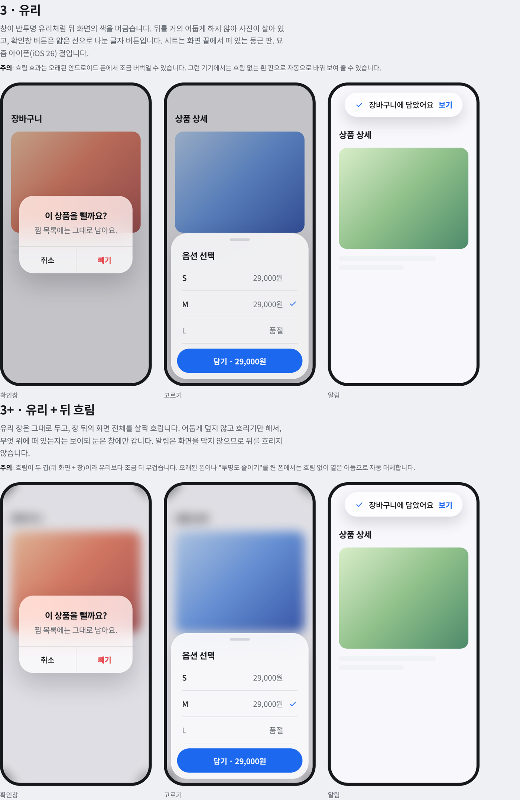
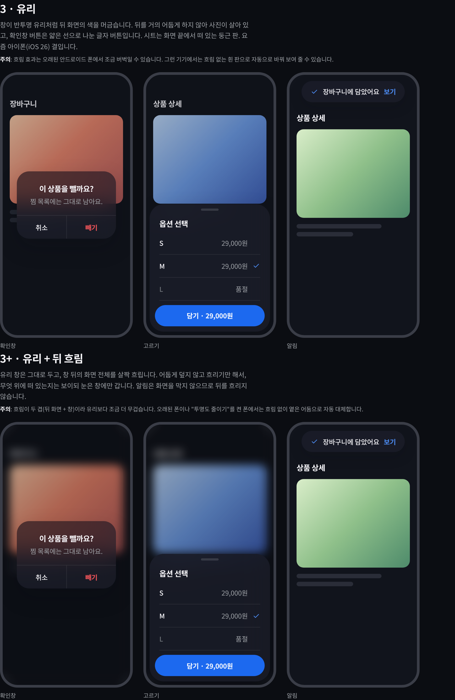
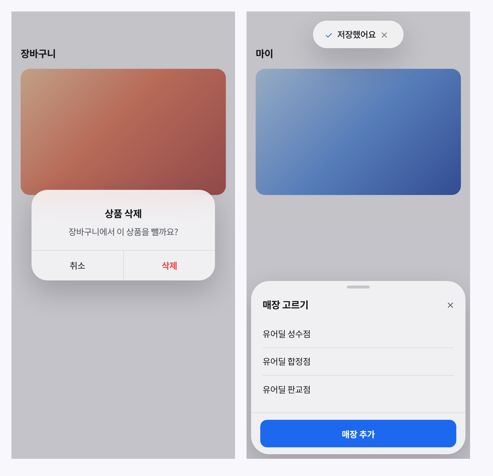
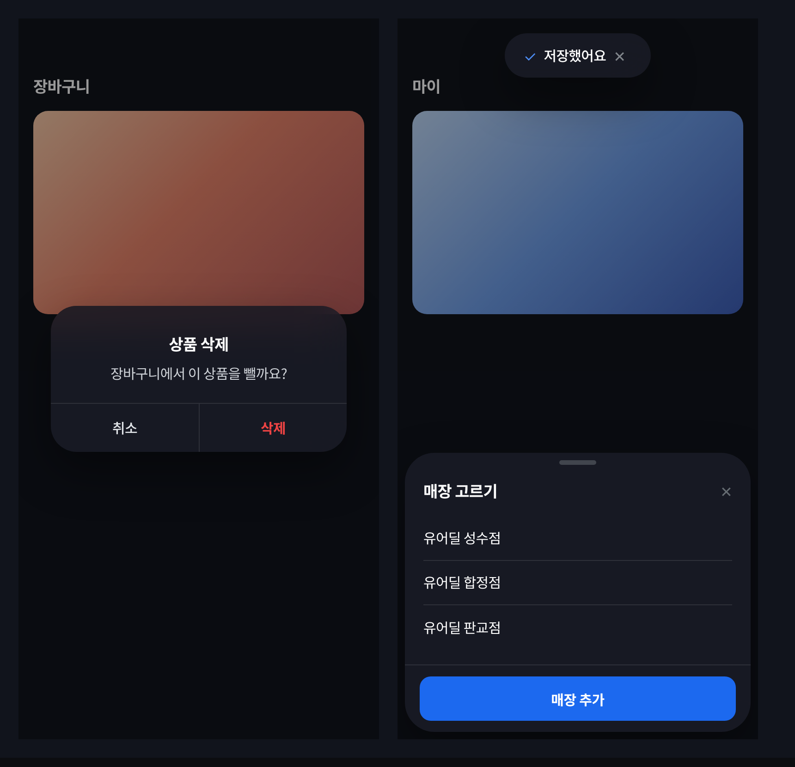

# 소비자 팝업·알림 통합 시안 (2026-11-02)

**시안 페이지**: https://claude.ai/artifact/WJR6c4m5kBCadeboN5ycuj (세션이 그린 시안 — 대표 승인 대기)
**대표 요청**: *"우리 유어딜 서비스에서 나타나는 팝업들의 디자인이 별로야. 전체적으로 통합관리해서 변경할 필요가 있어보여"*

## 실측 (소비자 화면, 대시보드 제외)
| 항목 | 값 |
|---|---|
| 팝업을 직접 그리는 파일 | 61 |
| 뒤 어둠 진하기 | 9종 (`bg-black/40`~`/90`) |
| z-index | 15종 (`z-50`·`z-[9999]`·`z-[10000]`~`z-[100000]`, `Z.*` 상수는 일부만) |
| 확인 버튼 색 | 공용 확인창(`confirm-dialog.tsx`)은 잉크 `#16181C`, 다른 곳은 파랑 — 혼재 |
| 알림(토스트) 부품 | 두 벌 — `components/Toast.tsx`(초록·빨강·파랑 상자) / `components/ToastContainer.tsx`(흰 알약 13px) |
| 이미 있는 좋은 셸 | `pages/user-profile/seller-section/Sheet.tsx` (뒤로가기 닫기 · PC 가운데 · `Z.SHEET_*`) — 마이·에이전시 시트만 사용 |

## 대표 결정
1. 1차 시안 세 안(A 전부 하단 시트 / B 확인 가운데·고르기 아래 / C 떠 있는 시트) 중 *"안 B가 좋긴 한데 디자인 변경이 필요해 더 세련되게"*
2. 범위: **소비자 화면 전부** (대시보드 제외)
3. *"알림 관련 팝업도 모두 적용인거지?"* → 예, 토스트 포함. 자리는 2026-09-02 확정(위 가운데) 유지.

## 2차 시안 (B 다듬기)
- **B1 또렷하게**: 왼쪽 정렬 카드, 버튼 둘 나란히(보조 = 연한 파랑), 고른 줄 = 연한 파랑 면
- **B2 차분하게**: 가운데 정렬 카드, 주 버튼 하나 + 글자 버튼, 시트는 줄과 체크
- 공통: 뒤 어둠 한 값 · 층 두 단 · 카드 모서리 24 · 버튼 52/14 · 손잡이 + 둥근 닫기 · 정보상자·이모지 0 · PC 는 가운데 창
- 알림: 한 벌로 합침, 15px · 높이 56 · 아이콘 원(성공 파랑/오류 빨강/안내 회색) · 바로가기("보기") 선택

4. **B2 · 차분하게 확정** (2026-11-02 대표 *"B2 차분하게. 화이트 모드에선 어떻게 나와?"*)

## B2 렌더 (Chromium, 실제 시안 페이지 캡처)
| 라이트 | 다크 |
|---|---|
|  |  |

알림(라이트): 

5. B2 렌더를 보고 *"뭔가 세련된 느낌이 없는데"* → 원인 진단(꽉 찬 빨강 버튼 · 카드가 폭을 다 씀 · 탁한 회색 막 · 각진 버튼과 장식 중복) 후 **3차 시안 세 방향**: 1 잉크(흑백 알약, 주 버튼 잉크 — 브랜드 규칙 예외 필요) · 2 블루 절제(규칙 안) · 3 유리(반투명 흐림, iOS 26 결). 대표 선택 대기.

| 3차 · 라이트 | 3차 · 다크 |
|---|---|
|  |  |

6. 대표 *"유리로 하고 뒷 배경 블러처리 하는건 어때?"* → **3 유리 선택**. 뒤 흐림 변형(3+: 뒤 화면 blur 10px + 옅은 막, 알림은 흐림 없음)을 시안으로 그림 — 흐림 여부 결정 대기. 흐림 미지원·투명도 줄이기 기기는 옅은 막으로 대체.

| 유리 vs 유리+뒤 흐림 · 라이트 | 다크 |
|---|---|
|  |  |

7. **확정: 유리(뒤 흐림 없음)** — 대표 *"아니다 그냥 블러 없이 유리로 하자."*

## ✅ 구현 (PR #2112)
빌드된 CSS 로 실제 클래스를 그린 캡처(확인창 · 시트 · 알림):

| 라이트 | 다크 |
|---|---|
|  |  |

- 클래스 SSOT: `src/index.css` `.ur-veil` · `.ur-glass` · `.ur-glass-rule` · `.ur-pop-card|sheet|toast` · `.ur-dialog-in`
- 가드: `src/tests/unit/popup-glass-2026-11-02.test.ts`
- 범위 밖(그대로): 대시보드 팝업 · 전체화면 뷰어 · 운영자 몰 · 유어애즈 · 잠금표 파일 · z-index 통일

## 구현 todo (확정안)
- [x] `components/ui/` 에 `Dialog`(가운데 확인) · `Sheet`(하단/PC 가운데) · 토스트 하나 — `seller-section/Sheet.tsx` 의 히스토리·Z 규약을 그대로 승격
- [x] `confirm-dialog.tsx` 를 새 Dialog 로 (잉크 버튼 → 브랜드)
- [x] 화면별 팝업 이행 (잠금표 파일 · 대시보드 · 다른 서비스 제외)
- [x] 옛 `Toast.tsx` 호출부를 `ToastContainer` 쪽으로 합치고 삭제
- [x] 가드: 소비자 화면에서 `fixed inset-0` + `bg-black/` 직접 작성 금지(래칫)
