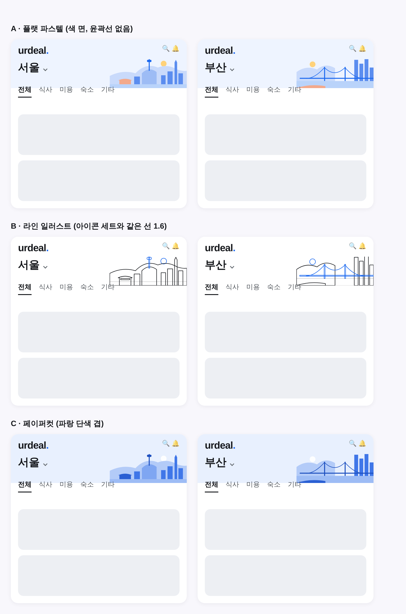

# 홈 지역 머리 — 사진 → 도시 일러스트 (2026-11-01 시안)

대표: *"사진들 디자인이 너무 촌스럽네 컨셉을 전체적으로 바꿔서 각 도시 일러스트 느낌으로 가야겠는데?"*

## 시안 (서울 · 부산 두 도시로 비교)
| 안 | 느낌 | 이 레포 체계와의 관계 |
|---|---|---|
| A 플랫 파스텔 | 색 면, 윤곽선 없음, 따뜻한 포인트 한 색 | 카테고리 타일(`category-icons.tsx`)과 같은 flat 채색 |
| B 라인 | 잉크 선 1.6 + 랜드마크만 브랜드 블루 | 하단 탭·목록 아이콘(`urdeal-icons.tsx`)과 같은 선 |
| C 페이퍼컷 | 브랜드 블루 단색 3~4톤 겹 | 브랜드 색 하나로 통일 |

## 현재 vs 시안
| | 현재 | 시안 |
|---|---|---|
| 그림 | 도시 사진(webp 30~70KB, 머리 전체 배경) | 오른쪽 위 작은 SVG 일러스트(장당 1~2KB) |
| 글자 가독 | 흰 막·그라데이션으로 보정 | 그림이 글자 칸을 안 덮어 보정 불필요 |
| 다크 | 어두운 막 | 색만 토큰으로 바꿔 그대로 |
| 16개 지역 | 사진 수급(Figma 한도)에 막힘 | 코드로 그려 한도 없음 |

## 구현 todo (안 확정 후)
- [ ] 16개 지역 랜드마크 정하기(서울 N타워·롯데타워, 부산 광안대교 …)
- [ ] `src/components/region/RegionIllustration.tsx` — 지역별 SVG, 색은 토큰
- [ ] `home-region-hero.ts` 의 사진 표 → 일러스트 표, 머리 레이아웃 정리(그라데이션 막 제거)
- [ ] 옛 webp 삭제 + 시험 갱신
