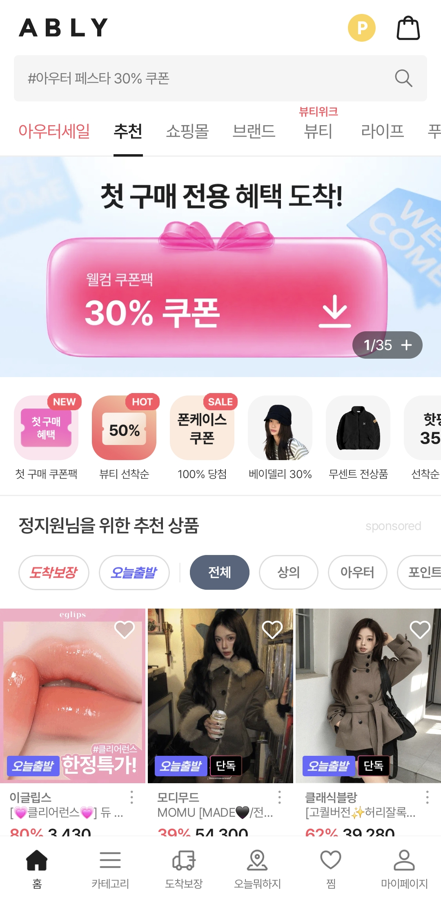
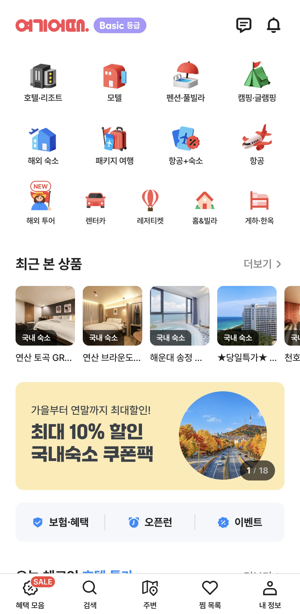
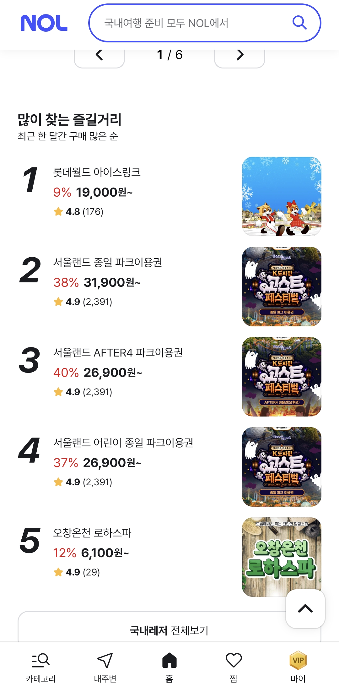
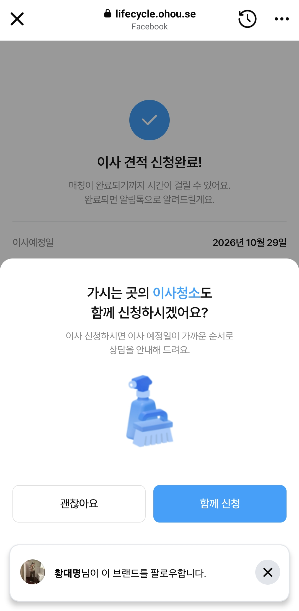
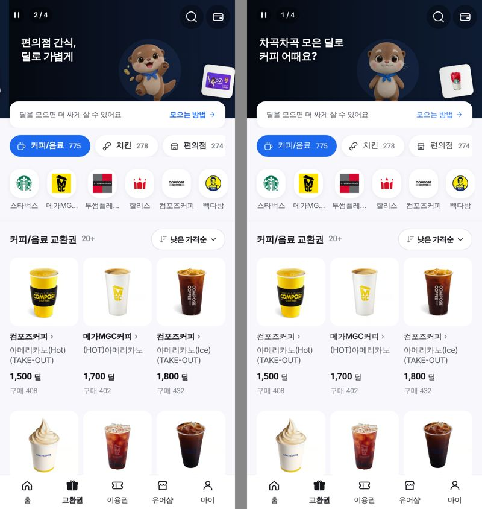
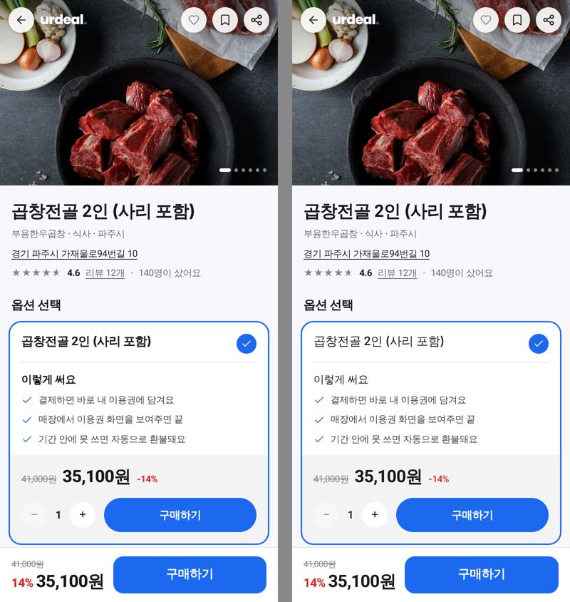
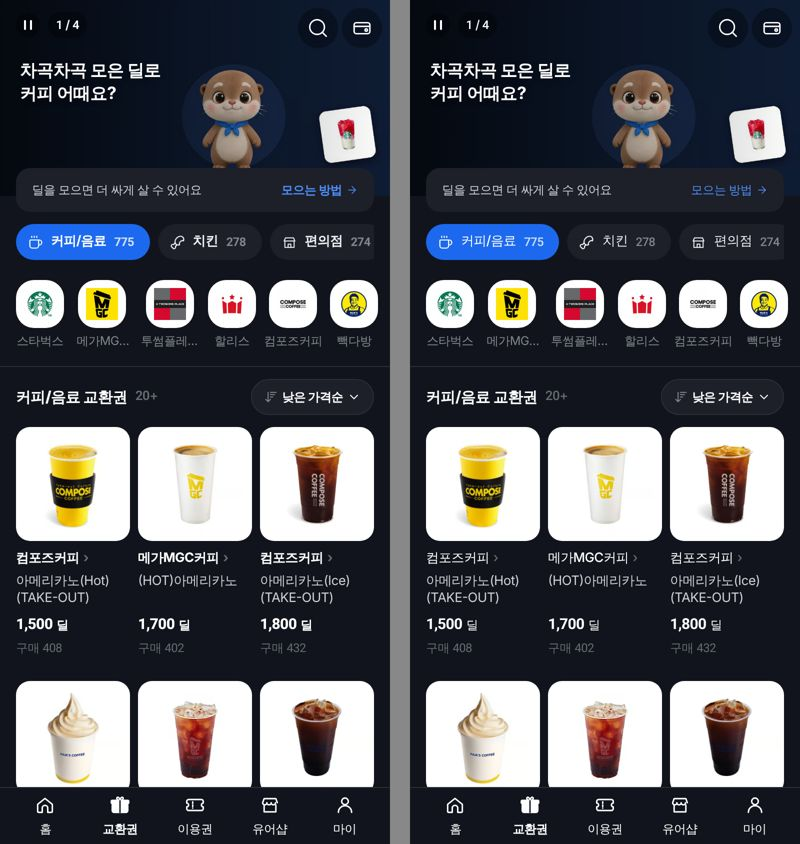
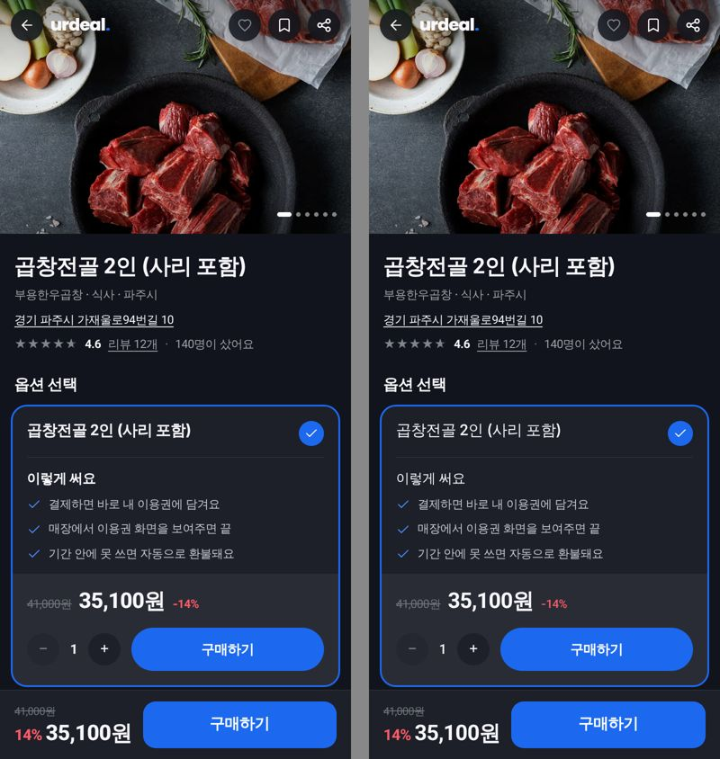

# 글자 굵기 체계 (2026-10-25)

대표: *"글자 폰트는 문제삼지 않을게. 근데 굵기, 크기 등의 전반적인 것들이 투박함이 남아있는 것 같아. 간격이라던지..
내가 다른 서비스들 화면들을 보내줄테니까 참고해볼래?"* → *"체계적으로 하자."*

## 참고 화면
| 에이블리 | 여기어때 | NOL | 오늘의집 |
|---|---|---|---|
|  |  |  |  |

공통점: 굵게는 **섹션 제목과 가격 숫자**에만. 상품명·카테고리·설명은 보통/중간. 아주 굵은 글자는 배너 홍보 문구에만.

## 유어딜 실측 (라이브 첫 화면, 390px)
| 화면 | 굵은 글자(600+) 비율 | 500 사용 |
|---|---|---|
| 교환권 `/vouchers` | 73% (96개 중 70) | 0 |
| 유어샵 `/u/jiwon1228` | 80% (50개 중 40) | 0 |
| 홈 `/` | 62% (50개 중 31) | 0 |
| 이용권 상세 `/pass/2835` | 45% (38개 중 17) | 0 |

## 정본 (CLAUDE.md 🎫 ⑨)
| 굵기 | 자리 |
|---|---|
| 400 | 설명 · 가게명 · 보조 정보 |
| 500 | 상품명 · 목록 제목 · 탭 · 칩 · 작은 강조 |
| 700 | 섹션 제목 · 가격 숫자 · 주 버튼 (15px 이상) |
| 800 | 디스플레이(28px+)만 |

600 · 900 · 12·13px 의 700+ 금지. 한 덩어리에 굵은 제목은 하나.

## 1차 이행 — 교환권 · 이용권 상세 (왼쪽 전 / 오른쪽 후)
| | 교환권 | 이용권 상세 |
|---|---|---|
| 라이트 |  |  |
| 다크 |  |  |

측정(같은 라이브 데이터): 교환권 700+ **73% → 11%** · 500 **0 → 58개** / 이용권 상세 700+ 45% → 34%.
⚠️ 비교 사진은 이 컨테이너의 글꼴(시스템 대체)로 그렸다 — 실제 폰(Apple SD Gothic Neo)에서는 500 이 더 또렷이 구분된다.

## 남은 일
- [ ] 나머지 소비자 화면 이행(래칫 1,343건) — 홈 · 유어샵 · 지도 · 마이 순
- [ ] 간격: 섹션 사이 / 섹션 안 차이를 화면별로 재서 맞춘다(아직 수치 없음)
- [ ] 하단 탭 활성 라벨 600(`BottomNav` — 잠금표) · 배너 카운터
